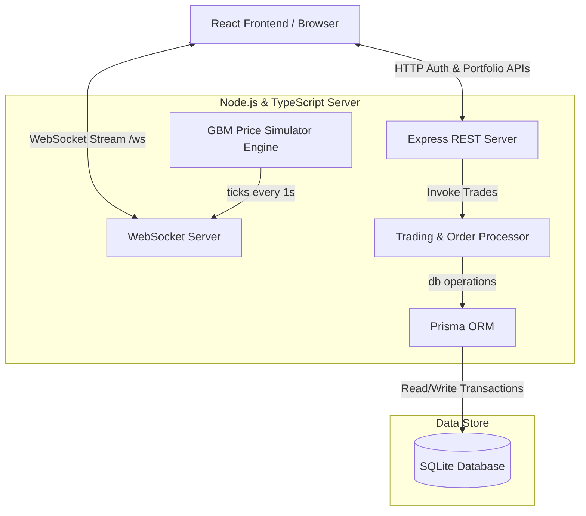

# QuantFlow ⚡ | Real-Time Stock Simulator & Portfolio Manager

A full-stack, real-time paper trading and portfolio simulator designed with **clean architecture**, **atomic transactional safety**, and **high-frequency UI updates**.

This project is built from scratch using **TypeScript** across the entire stack, proving robust software engineering (SDE) capabilities in real-time network services, database design, and frontend performance.

---

## 🚀 Key SDE Highlights (For Your Resume)

*   **Real-time Streaming Engine**: Implemented a low-latency price broadcast module using **WebSockets (`ws`)** that pushes high-frequency market updates directly to frontend consumers, bypassing expensive HTTP polling overhead.
*   **Algorithmic Price Simulation**: Modeled realistic stock market fluctuations using **Geometric Brownian Motion (GBM)** (via Box-Muller normal distribution transform) running inside a background tick worker.
*   **Atomic Concurrency Control**: Programmed the trading execution engine within **atomic database transactions (`Prisma.$transaction`)** to guarantee transaction isolation, preventing race conditions (such as double-spending cash balances or selling phantom shares).
*   **Real-Time Portfolio Valuation**: Designed a reactive frontend state machine that automatically recalculates total asset weights, profit/loss margins, and net portfolio value in real-time as prices tick in the browser.
*   **Docker Containerization**: Set up multi-stage production Docker configurations (`Dockerfile`, `docker-compose.yml`) for instant local deployments and microservice linking.

---

## 🛠️ Tech Stack

*   **Frontend**: React (Vite) + TypeScript + Vanilla CSS (Custom Glassmorphism design system)
*   **Backend**: Node.js + Express + TypeScript + WebSockets (`ws`)
*   **Database**: Prisma ORM + SQLite (highly flexible, swap-ready for PostgreSQL)
*   **Visualizations**: Recharts (gradient area chart, tooltips, responsive grids)
*   **Containerization**: Docker & Docker Compose
*   **Testing**: Vitest (Unit Testing)

---

## 📐 System Architecture



---

## 📦 Project Directory Structure

```text
├── backend/
│   ├── prisma/             # Schema definition & Migrations
│   ├── src/
│   │   ├── middleware/     # JWT Auth verification
│   │   ├── routes/         # REST API endpoints (Auth, Portfolio)
│   │   ├── services/       # GBM price engine, database link, trading transaction engine
│   │   └── tests/          # Vitest unit test suites
│   ├── Dockerfile
│   └── tsconfig.json
├── frontend/
│   ├── src/
│   │   ├── components/     # StockChart, TradingPanel, PortfolioOverview, AuthScreen, Dashboard
│   │   ├── context/        # Auth Session State Context
│   │   └── hooks/          # useStockWS WebSocket tick hooks
│   ├── index.html          # Outfit Typography config
│   ├── nginx.conf          # SPA Nginx routing configuration
│   └── Dockerfile
└── docker-compose.yml      # Orchestrates local launch
```

---

## 🚦 Getting Started

### Prerequisites
*   Node.js (v18+)
*   Docker & Docker Compose (Optional for container launch)

### Local Development Setup

1.  **Clone the workspace** and navigate to the project directory.
2.  **Initialize the Backend**:
    ```bash
    cd backend
    npm install
    npx prisma migrate dev --name init
    npm run dev
    ```
    *The backend server will launch on `http://localhost:5000` with the WebSocket endpoint mounted on `/ws`.*

3.  **Initialize the Frontend**:
    ```bash
    cd ../frontend
    npm install --legacy-peer-deps
    npm run dev
    ```
    *Open `http://localhost:5173` (or the terminal url) in your browser.*

### Running with Docker Compose
To build and launch the entire stack in isolated container networks:
```bash
docker-compose up --build
```
*   Visit the live frontend at `http://localhost:3000`
*   The backend handles requests at `http://localhost:5000`

---

## 🧪 Unit Testing

To verify the transaction safety of the order execution logic, run the backend unit tests:
```bash
cd backend
npm run test
```
The test suite verifies:
1.  Successful buy execution when balance is sufficient.
2.  Proper error trapping when purchase costs exceed available cash.
3.  Successful sell execution when shares are owned.
4.  Failed transactions when selling more shares than held.
