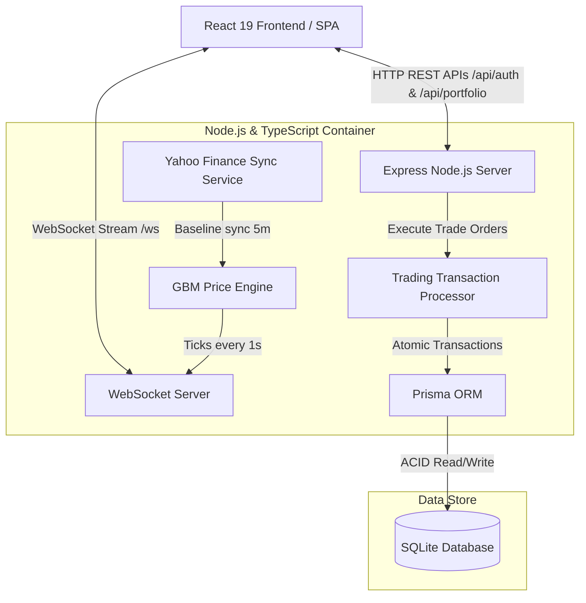

# QuantFlow ⚡ | Real-Time Stock Simulator & Portfolio Manager

<p align="center">
  
</p>

<p align="center">
  <a href="https://quantflow-8fu9.onrender.com/" target="_blank">
    
  </a>
  
  
  
  
  
  
</p>

<p align="center">
  <b>A full-stack, real-time paper trading platform and portfolio manager engineered for high-frequency market updates, atomic transaction safety, and algorithmic price simulation.</b>
</p>

---

> [!TIP]
> 🚀 **Explore Live**: Test drive the live deployed app right now at **[https://quantflow-8fu9.onrender.com/](https://quantflow-8fu9.onrender.com/)**

---

## ✨ Features at a Glance

* 📊 **High-Frequency WebSocket Price Feed**: Low-latency sub-second market updates pushed directly to the browser via custom WebSockets server (`/ws`).
* 🧮 **Geometric Brownian Motion (GBM) Engine**: Real-time algorithmic stock fluctuation simulator using Box-Muller normal distribution transformations anchored to live Yahoo Finance quotes.
* 🛡️ **Atomic Transaction Control**: Order execution powered by `Prisma.$transaction` isolation, preventing double-spending and share over-selling under concurrent requests.
* 💼 **Multi-Asset Support**: Trade across US Equities, Indian NSE Stocks, Gold & Commodity ETFs, Index Funds, and Mutual Funds with real-time USD/INR currency conversion.
* 📉 **Interactive Financial Charts**: Dynamic candlestick & gradient area charts with live interval candle formation powered by Recharts.
* 🎨 **Glassmorphism UI**: High-contrast, dark-mode financial dashboard built with custom Vanilla CSS design tokens.
* 🐳 **Unified Single-Container Docker Build**: Multi-stage Docker deployment serving both SPA frontend assets and Node.js backend on a unified port.

---

## 🧮 Mathematical Engine (GBM & Box-Muller)

QuantFlow simulates realistic stock market asset trajectories using **Geometric Brownian Motion (GBM)**, defined by the continuous-time stochastic differential equation (SDE):

$$\mathrm{d}S_t = \mu S_t \mathrm{d}t + \sigma S_t \mathrm{d}W_t$$

In discrete time, next step prices are calculated in [`backend/src/services/market.ts`](file:///e:/RProjects/quantflow/backend/src/services/market.ts) using exact logarithmic returns:

$$S_{t+\Delta t} = S_t \cdot \exp\left(\left(\mu - \frac{\sigma^2}{2}\right)\Delta t + \sigma \sqrt{\Delta t} \, Z\right)$$

Where $Z \sim \mathcal{N}(0, 1)$ standard normal random variables are generated using the **Box-Muller Transform**:

$$Z = \sqrt{-2 \ln(U_1)} \cdot \cos(2\pi U_2) \quad \text{for } U_1, U_2 \sim \text{Uniform}(0, 1)$$

---

## 🛠️ Tech Stack

| Layer | Technologies Used |
| :--- | :--- |
| **Frontend** | React 19, TypeScript, Vite, Recharts, Lucide Icons, Custom CSS (Glassmorphism) |
| **Backend** | Node.js, Express, TypeScript, WebSockets (`ws`), EventEmitter |
| **Database & ORM** | Prisma ORM, SQLite (Production Ready) |
| **Simulation** | Geometric Brownian Motion (GBM), Box-Muller Normal Distribution, Yahoo Finance API Sync |
| **DevOps & Hosting** | Docker, Docker Compose, Multi-stage Builds, Render Web Services |
| **Testing** | Vitest (Order Execution Unit Tests) |

---

## 📐 System Architecture



---

## 📂 Project Directory Structure

```text
quantflow/
├── backend/
│   ├── prisma/             # Database schema & migrations
│   ├── src/
│   │   ├── middleware/     # JWT Authentication middleware
│   │   ├── routes/         # REST API endpoints (Auth, Portfolio, Stocks)
│   │   ├── services/       # GBM price simulator, Trading transactions, Database client
│   │   └── tests/          # Vitest transaction test suites
│   ├── Dockerfile
│   └── tsconfig.json
├── frontend/
│   ├── src/
│   │   ├── components/     # Dashboard, StockChart, TradingPanel, PortfolioOverview, AuthScreen
│   │   ├── context/        # Dynamic Auth state provider
│   │   └── hooks/          # Real-time useStockWS WebSocket tick hooks
│   ├── index.html
│   └── Dockerfile
├── Dockerfile              # Production multi-stage full-stack docker build
├── docker-compose.yml      # Local microservice orchestration
└── render.yaml             # Render 1-click cloud blueprint
```

---

## 🚦 Local Quickstart

### Prerequisites
* **Node.js**: v18 or higher
* **Docker & Docker Compose**: (Optional, for container setup)

### 1. Run Locally with Node.js

#### **Backend Setup**
```bash
cd backend
npm install
npx prisma db push
npm run dev
```
*Backend server launches on `http://localhost:5000` with WebSocket mounted on `ws://localhost:5000/ws`.*

#### **Frontend Setup**
```bash
cd ../frontend
npm install --legacy-peer-deps
npm run dev
```
*Frontend opens at `http://localhost:5173`.*

---

### 2. Run with Docker Compose
To run the full stack isolated inside Docker containers:
```bash
docker-compose up --build
```
* Visit `http://localhost:3000` for the frontend and `http://localhost:5000` for backend REST APIs.

---

## 🧪 Unit Testing

To verify atomic transactional safety and trade validation:
```bash
cd backend
npm run test
```

Test cases covered:
1. ✅ **Valid Purchase**: Correctly updates cash balance and holdings.
2. ❌ **Insufficient Cash**: Traps double-spend errors and reverts transactions.
3. ✅ **Valid Sell**: Calculates capital gains and updates fractional holdings.
4. ❌ **Short Sell Protection**: Prevents selling more shares than held.

---

## 🌐 Live Deployment Link

* **Live App**: [https://quantflow-8fu9.onrender.com/](https://quantflow-8fu9.onrender.com/)
* **Platform**: Render Cloud (Docker Container Web Service)

---

<p align="center">
  Designed & Built with ❤️ for High-Performance Quantitative Engineering.
</p>
